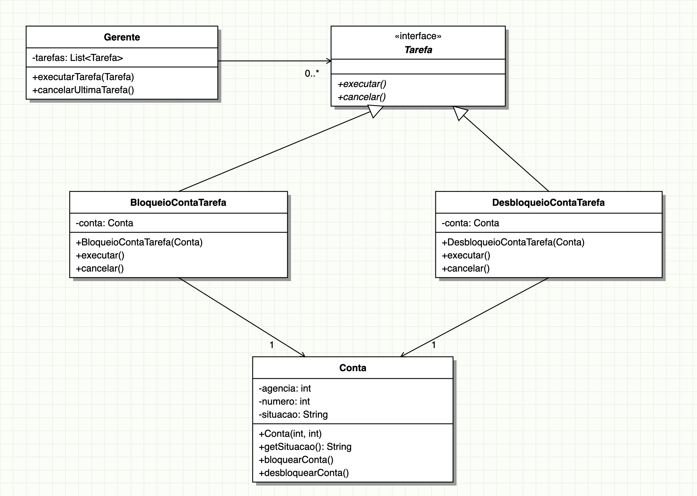

# Command — Bloqueio de Conta

Implementação do padrão de projeto **Command**, aplicada ao bloqueio e desbloqueio de contas bancárias.

## Diagrama UML



Versão editável em Mermaid: [docs/diagrama-uml.md](docs/diagrama-uml.md).

## Como rodar os testes

```
mvn test
```
